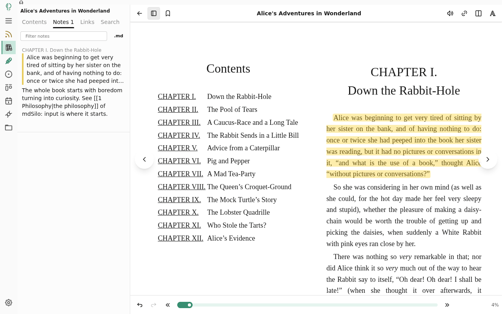
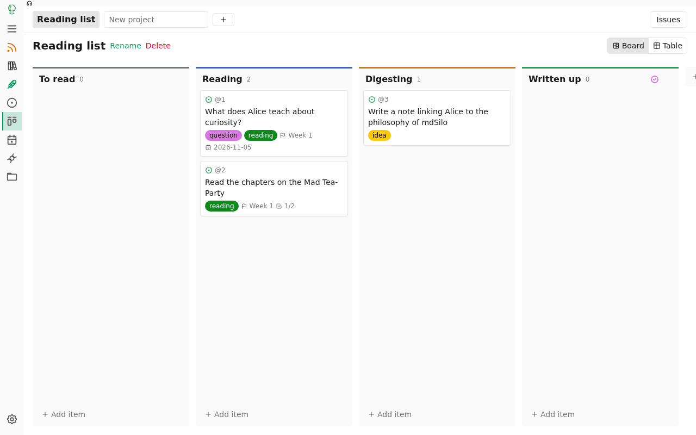
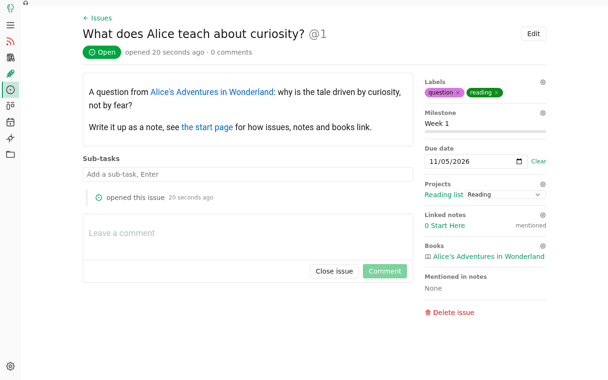
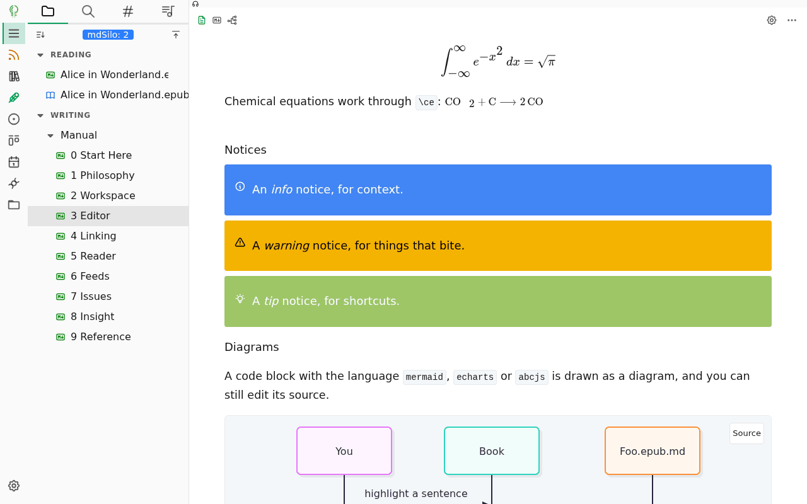
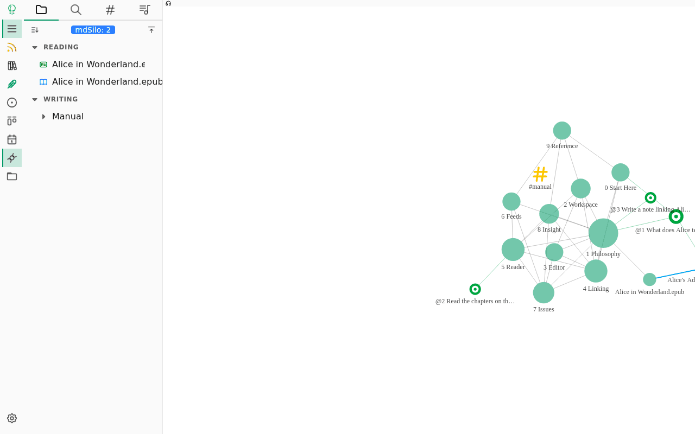

# mdSilo

**A hub for your personal I/O: Reading → Issue → Writing.**

mdSilo is a local-first workspace where what you *read*, what you *think* and what you *write* live together, linked, searchable and yours. It is a Markdown notebook, a book reader, a feed reader and an issue tracker in one small app (React + [Tauri](https://github.com/tauri-apps)), on top of plain files.

[Try it in your browser](https://mdsilo.com/app/) · [User manual](docs/manual/0%20Start%20Here.md) · [Discord](https://discord.gg/EXYSEHRTFt) · [Bluesky](https://bsky.app/profile/mdsilo.com)

## Why mdSilo

For a human brain, reading and writing are the I/O: the way a thinking system talks with the world. Most note apps only care about the last step, the writing. But writing without reading is empty, and what you read is gone in a week if there is no place to digest it.

So mdSilo is built around the whole loop, and gives each step its own tool:

| | Step | Tool | In mdSilo |
|---|------|------|-----------|
| 📖 | **Reading** (input) | Reader, Feeds, Podcasts | Books (EPUB, PDF, MOBI, FB2, CBZ...), RSS/Atom, podcasts and clipped web pages; highlight and annotate anything |
| 🧩 | **Issue** (process) | Issues, Projects | A GitHub-like tracker for the questions, ideas and tasks that reading raises: labels, milestones, boards |
| ✍️ | **Writing** (output) | WYSIWYG Markdown editor | Notes, a personal wiki, mind maps, diagrams, math |

And **links** close the loop: a note links to a book (`{{Alice's Adventures in Wonderland}}`), to a sentence in it, to an issue (`[@3](issue:3)`) and to other notes (`[[Philosophy]]`). Every link is two-way, and the Graph draws the whole network.

Everything is a plain file in a folder you choose: Markdown for notes and annotations, JSON for issues and the library. No account, no server, no lock-in; sync it with git or anything else(coming soon).

## Features

### 📖 Read: the input

- **Book reader** for EPUB, PDF, MOBI/AZW3, FB2 and CBZ; TXT, Markdown and HTML are converted on import. Paging or scrolling, themes, fonts, margins, footnotes, image and table viewer
- **Highlight, write notes, bookmark**: kept as a Markdown file next to the book (`Foo.epub.md`), a note like any other: editable, searchable, linkable
- **Look up as you read**: dictionary, Wikipedia, translation, read aloud; words go to a vocabulary with flash cards
- **Parallel reading**: two books side by side, each with its own notes
- **Library**: covers, groups, status, search, drag and drop; books are identified by content, so a renamed book is still the same book
- **Feeds & podcasts**: RSS/Atom client with full text, starred articles, clipping to notes and a podcast player; turn a channel into an EPUB and read a month of news as a book

### 🧩 Process: Issue

- **Issues** with labels, milestones, due dates, subtasks, comments and a timeline, plus a GitHub-style filter (`is:open label:question sort:due`)
- **Projects**: Kanban boards and tables, with any statuses you want (*To read → Reading → Digesting → Written up*)
- **Born where the thought is**: select a sentence in a book or a note and choose *New issue of it*; the quote and a link back become the issue
- **Tasks in notes**: `- [ ]` checkboxes and `#todo#` `#doing#` `#done#` tags are collected in one list and can become issues that stay in sync

### ✍️ Write: the output

- **All-in-one editor**: WYSIWYG, raw Markdown and Mind Map views of the same file
- **Markdown and more**: tables, task lists, `==highlight==`, math and chemistry (KaTeX), notices, mermaid / echarts / abc music, code highlighting, embeds, attachments
- **Slash commands**, a hovering toolbar and hotkeys: never leave the keyboard
- **Export** to PDF and PNG

### 🔗 Link and see

- **Bidirectional links**: `[[notes]]`, `{{books and highlights}}`, `[@12](issue:12)`, `#tags#`, backlinks and unlinked mentions
- **Graph**: notes, books, issues and tags in one network
- **Chronicle**: daily journals and a GitHub-like activity heat map of your writing *and* reading
- **Full-text search** over notes, annotations and the text of your books, Chinese included
- **Dark and light**, 10 themes; Windows, macOS, Linux and Web; free and open source

## Learn more

The [user manual](docs/manual/0%20Start%20Here.md) covers every part in detail (also in Chinese: [中文手册](docs/manual-zh/0%20开始.md)). The web version opens with the manual already in your workspace (in Chinese for a Chinese browser), together with a public domain sample book ([Project Gutenberg](https://www.gutenberg.org/ebooks/11)) and a few issues to play with; click around and break things. When you are done, **File Menu > Remove demo** clears all of it in one click and keeps what you made.

1. [Philosophy](docs/manual/1%20Philosophy.md)
2. [Workspace](docs/manual/2%20Workspace.md)
3. [Editor](docs/manual/3%20Editor.md)
4. [Linking](docs/manual/4%20Linking.md)
5. [Reader](docs/manual/5%20Reader.md)
6. [Feeds](docs/manual/6%20Feeds.md)
7. [Issues](docs/manual/7%20Issues.md)
8. [Insight](docs/manual/8%20Insight.md)
9. [Reference](docs/manual/9%20Reference.md)

## Get the app

You can get the app on [release page](https://github.com/mdSilo/mdSilo-app/releases) or build from the source code: 

- install Rust: https://www.rust-lang.org/tools/install 
- install Node js: https://nodejs.org, and pnpm: `corepack enable` (or see https://pnpm.io/installation)
- `git clone https://github.com/mdSilo/mdSilo-app.git`
- `cd mdSilo-app`
- `pnpm install && pnpm tauri build` 

Then you can find the app in `./src-tauri/target/release` folder.

### Web version

The web version shares the frontend code in `./src` with the desktop app, files are stored in the browser (IndexedDB) instead of the disk. No Rust is needed: 

- `pnpm start:web`: dev server on http://localhost:3001
- `pnpm build:web`: build to `./dist-web`, a static site that can be served by any web server (set `MDSILO_WEB_BASE=/sub/path/` to serve from a sub path)

How it works: `vite.web.config.mts` replaces the Tauri APIs (`@tauri-apps/api/*`, `@tauri-apps/plugin-dialog`) with the stand-ins in `./src/host/web`, which handle the same commands as the Rust end (`src-tauri/src/lib.rs`) on a virtual file system in IndexedDB. A service worker (`./web/public/fs-sw.js`) serves the stored files by URL, so images and attachments can be displayed. Folders and files on your device can be imported via the Open Folder / Open File dialog, exported files are downloaded by the browser.

Backup: clearing the site data of the browser deletes the notes, so back up regularly via the **File Menu** (the folder icon of the side menu) > **Backup**, which downloads all files as a zip. To restore, unzip it and import the folder via Open Folder > Import Folder.

RSS feeds: browsers block most feeds by CORS, so a feed is fetched directly first, then via a CORS proxy. The proxy in use, in order:

1. Settings > RSS CORS Proxy, e.g. `https://proxy.example.com/?url={url}` (`{url}` is replaced by the encoded feed url, otherwise the url is appended); `none` to disable
2. build time default: `MDSILO_WEB_CORS_PROXY=https://proxy.example.com/?url={url} pnpm build:web`
3. the built-in proxy `/__cors_proxy__` of `pnpm start:web` / `pnpm preview:web`, if detected
4. a public proxy ([allorigins](https://allorigins.win)) on static hosting, which can see the feed urls

To run your own proxy (same API, GET to public http(s) addresses only):

- Node: `node web/cors-proxy.mjs` (no dependencies; env `PORT`, default 8787, `HOST`, `ALLOW_ORIGIN`)
- Cloudflare Workers, for static hosting w/o a server (free tier is enough): `npx wrangler deploy web/cors-proxy-worker.mjs --name mdsilo-cors-proxy --compatibility-date 2024-09-01 --var ALLOW_ORIGIN:https://<your site origin>`

Deploy to GitHub Pages: `.github/workflows/deploy-web.yml` builds and deploys on push to `main` (or run it manually). Enable it in repo Settings > Pages > Source: **GitHub Actions**. With repo secrets `CLOUDFLARE_API_TOKEN` (Workers edit permission) and `CLOUDFLARE_ACCOUNT_ID`, it also deploys the Cloudflare Worker proxy and builds it in as the default; or set repo variable `MDSILO_WEB_CORS_PROXY` to use an existing proxy. Other variables: `MDSILO_WEB_BASE` (default `/<repo name>/`, use `/` for a custom domain), `MDSILO_WEB_ORIGIN` (origin allowed by the proxy, default `https://<owner>.github.io`), `MDSILO_CORS_WORKER_NAME`.

## Tech Stack

- Editor Framework: [ProseMirror](https://prosemirror.net/)      
- Frontend Framework: [React](https://reactjs.org/)  
- Cross-platform: [Tauri](https://tauri.app/) 

## Road map

### Input

- [X] RSS, Atom and podcasts
- [X] Read and annotate EPUB, PDF, MOBI, FB2, CBZ; library, parallel reading, dictionary, vocabulary, read aloud
- [X] Feeds into books
- [ ] AI helpers, OPDS

### Process

- [X] Issues, labels, milestones, subtasks, due dates
- [X] Projects: boards and tables
- [X] Tasks in notes, issues from highlights and selections
- [ ] Flashcards

### Output

- [X] Markdown: style, link, image, headings and TOC, lists, tables, quotes
- [X] Extensions: mark, underline, sup, highlighted code, math and chemistry, notices, wikilink `[[]]`, hashtag `#tag#`, diagrams (mermaid, echarts, abc), embeds, attached PDF
- [X] WYSIWYG, Markdown and Mind Map; slash commands, hovering toolbar, hotkeys
- [X] Export as PDF and PNG
- [ ] Drawing
- [ ] Block reference
- [ ] Publish a static site

### Link and see

- [X] Backlinks, unlinked mentions, links to books and issues
- [X] Graph, Chronicle, activity heat map
- [X] Full-text search
- [ ] Version control: git sync

### Extension

- [ ] Plugin
- [ ] Customize theme

### Cross-platform

- [X] Windows, macOS, Linux
- [X] Web: https://mdsilo.github.io/mdSilo-app/
- [ ] Mobile: iOS/iPadOS and Android

## Any questions, feedback or suggestions?

You can follow us on [Bluesky](https://bsky.app/profile/mdsilo.com) or go to our [Discord](https://discord.gg/EXYSEHRTFt). We are waiting there for you.
