# mdSilo

**A hub for your personal I/O: Reading → Issue → Writing.**

mdSilo is a local-first workspace where what you *read*, what you *think* and what you *write* live together, linked, searchable and yours. It is a Markdown notebook, a book reader, a feed reader and an issue tracker in one small app (React + [Tauri](https://github.com/tauri-apps)), on top of plain files.

[Try it in your browser](https://mdsilo.github.io/mdSilo-app/) · [User manual](docs/manual/0%20Start%20Here.md) · [Discord](https://discord.gg/EXYSEHRTFt) · [Bluesky](https://bsky.app/profile/mdsilo.com)

Install or Update Desktop App in one line command: 

On Linux it picks the .deb, .rpm or AppImage for your distro, on macOS it puts the app in /Applications (options: `--version`, `--format`, `--uninstall`, see `--help`):

```sh
curl -fsSL https://raw.githubusercontent.com/mdSilo/mdSilo-app/main/scripts/install.sh | sh
```

On Windows, in PowerShell (no admin needed; options `-Version`, `-Format msi`, `-Uninstall`:

```powershell
irm https://raw.githubusercontent.com/mdSilo/mdSilo-app/main/scripts/install.ps1 | iex
```

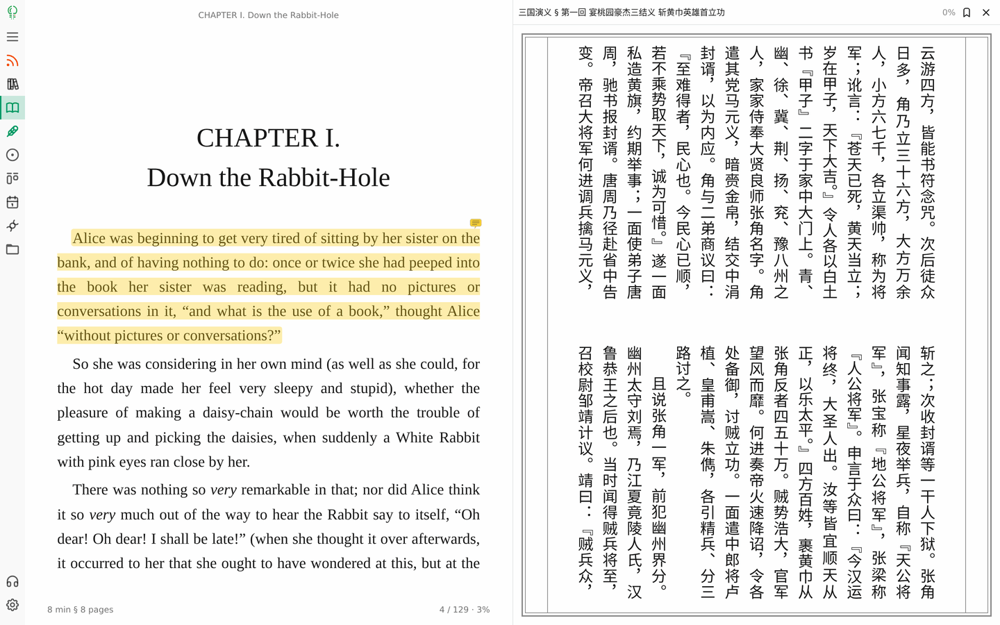

## Why mdSilo

For a human brain, reading and writing are the I/O: the way a thinking system talks with the world. Most note apps only care about the last step, the writing. But writing without reading is empty, and what you read is gone in a week if there is no place to digest it.

So mdSilo is built around the whole loop, and gives each step its own tool:

| | Step | Tool | In mdSilo |
|---|------|------|-----------|
| 📖 | **Reading** (input) | Reader, Feeds, Podcasts | Books (EPUB, PDF, MOBI, FB2, CBZ...), RSS/Atom/JSON Feed, podcasts and clipped web pages; highlight and annotate anything |
| 🧩 | **Issue** (process) | Issues, Projects | A GitHub-like tracker for the questions, ideas and tasks that reading raises: labels, milestones, boards |
| ✍️ | **Writing** (output) | WYSIWYG Markdown editor | Notes, a personal wiki, mind maps, diagrams, math |

And **links** close the loop: a note links to a book (`{{Alice's Adventures in Wonderland}}`), to a sentence in it, to an issue (`[@3](issue:3)`) and to other notes (`[[Philosophy]]`). Every link is two-way, and the Graph draws the whole network.

Everything is a plain file in a folder you choose: Markdown for notes and annotations, JSON for issues and the library. No account, no server, no lock-in; sync it with git right from the app (or with anything else), and publish the notes you choose as a website.

## Features

### 📖 Read: the input

- **Book reader** for EPUB, PDF, MOBI/AZW3, FB2 and CBZ; TXT, Markdown and HTML are converted to EPUB on import. Paging or scrolling, page colors, your own fonts (and a CJK font), margins, footnotes, image and table viewer, a reading ruler
- **Vertical writing**: read Chinese, Japanese or Korean top to bottom, right to left, with a classic double border; or set any book horizontal, right to left
- **Comics and PDFs**: zoom, one or two pages, a webtoon strip, right-to-left pages for manga
- **Highlight, write notes, bookmark**: a toolbar on the text you select (highlight, note, look up, translate, read aloud, quote, link, new issue), handles to change the range; all kept as a Markdown file next to the book (`Foo.epub.md`), a note like any other: editable, searchable, linkable
- **Look up as you read**: your dictionaries in your order (Wiktionary, Wikipedia, Urban Dictionary, Merriam-Webster, sites you add, MDict files), with pronunciations, in books and notes
- **Translate and listen**: translate a selection, or the whole book as you read (beside the text or in its place) and save it as a translated EPUB; read aloud with the voices of your system, Piper, Azure or an OpenAI-like service
- **Vocabulary**: words kept with their pronunciation and the sentence they came from, studied as flash cards; the **word lens** shows their meaning under them in the books
- **Parallel reading and writing**: two books side by side, each with its own notes: a translation and its original, a text and its commentary; or a note beside the book, the text dragged into it as a quote with a link back; or two notes side by side
- **Library**: covers, groups, status, search, drag and drop; books are identified by content, so a renamed book is still the same book
- **Feeds & podcasts**: RSS/Atom/JSON Feed client with full text, starred articles, clipping to notes and a podcast player; turn a channel into an EPUB and read a month of news as a book; browse and download from OPDS catalogs

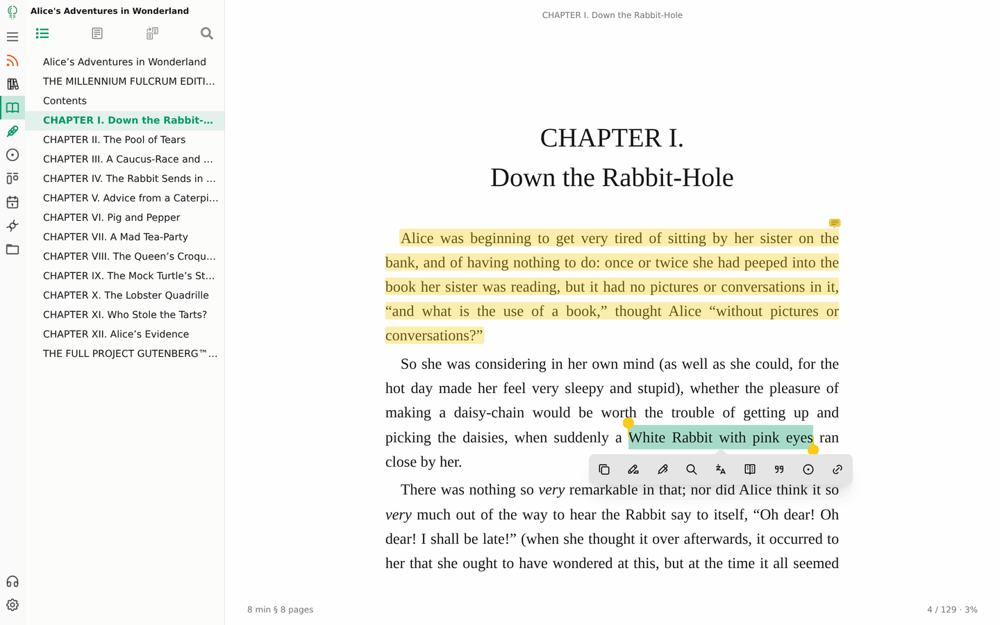

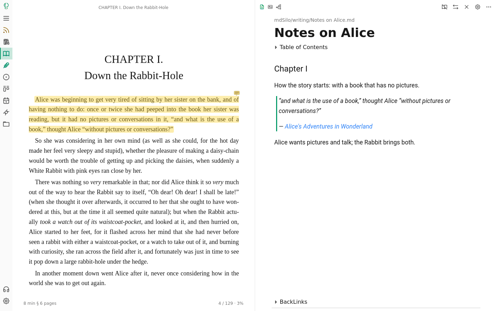

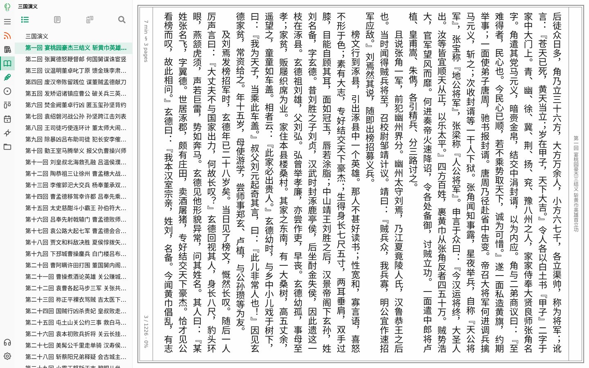

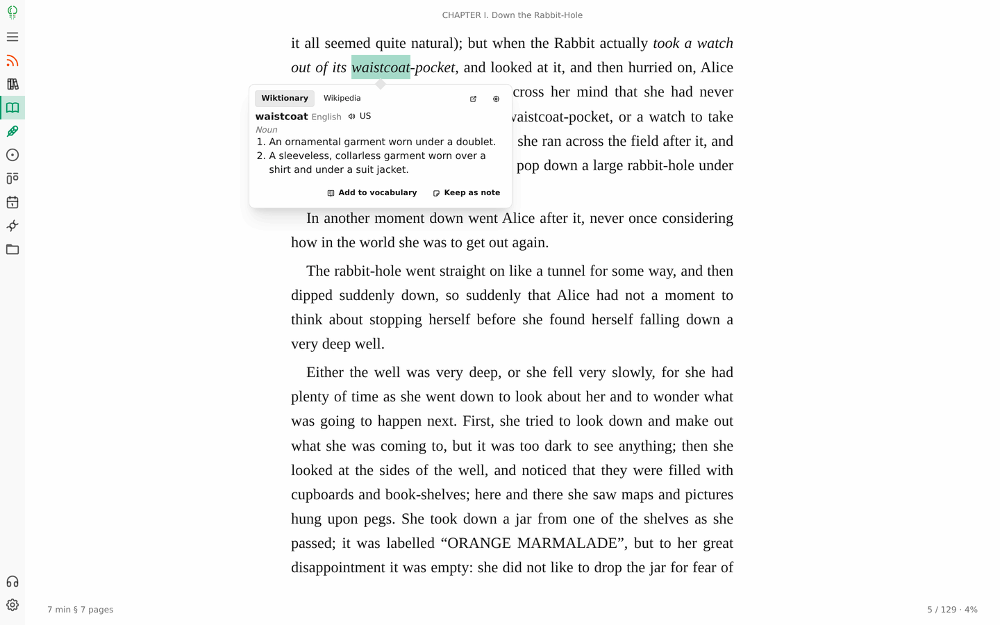

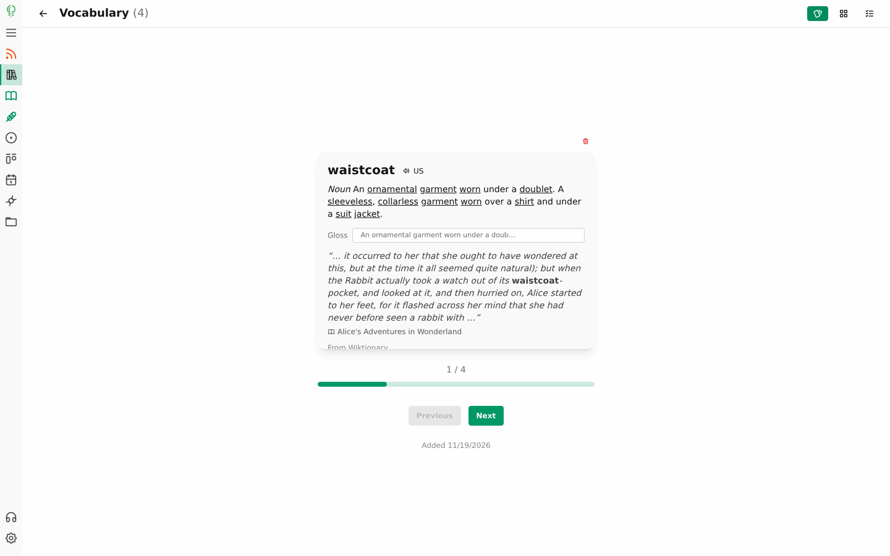

### 🧩 Process: Issue

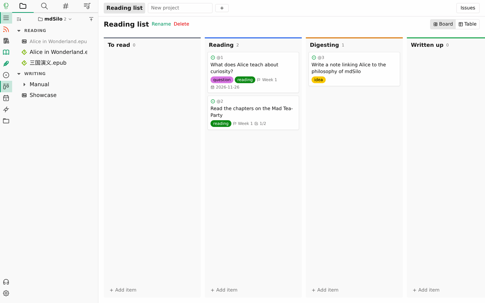

- **Issues** with labels, milestones, due dates, subtasks, comments and a timeline, plus a GitHub-style filter (`is:open label:question sort:due`)
- **Projects**: Kanban boards and tables, with any statuses you want (*To read → Reading → Digesting → Written up*)
- **Born where the thought is**: select a sentence in a book or a note and choose *New issue of it*; the quote and a link back become the issue
- **Tasks in notes**: `- [ ]` checkboxes and `#todo#` `#doing#` `#done#` tags are collected in one list and can become issues that stay in sync

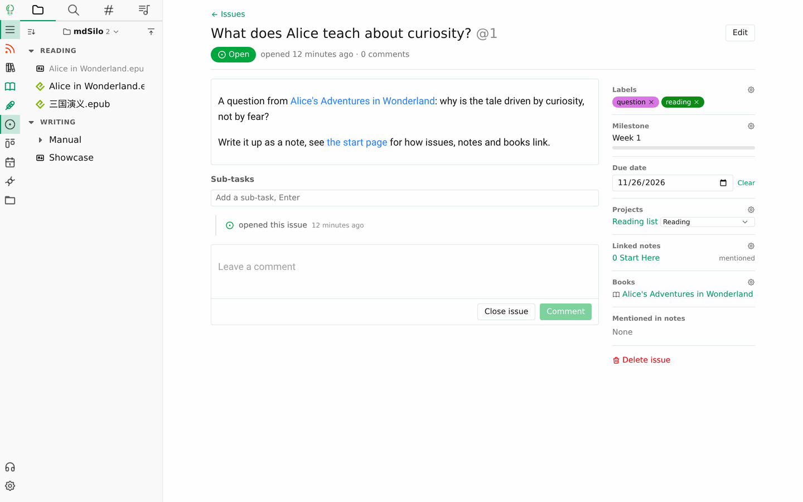

### ✍️ Write: the output

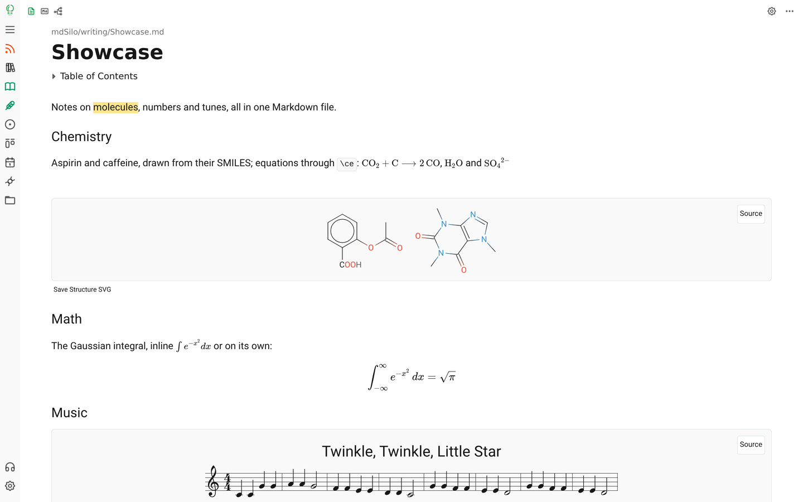

- **All-in-one editor**: WYSIWYG, raw Markdown and Mind Map views of the same file
- **Markdown and more**: tables, task lists, `==highlight==`, sub- and superscript, math and chemistry (KaTeX), notices, diagrams (mermaid, echarts), music notation you can play (abc), chemical structures (SMILES), code highlighting, embeds, attachments; each drawing can be saved as SVG
- **Slash commands**, a hovering toolbar and hotkeys: never leave the keyboard. The toolbar on the text selected also copies it, looks it up in your dictionaries and makes an issue of it
- **Export** to PDF and PNG

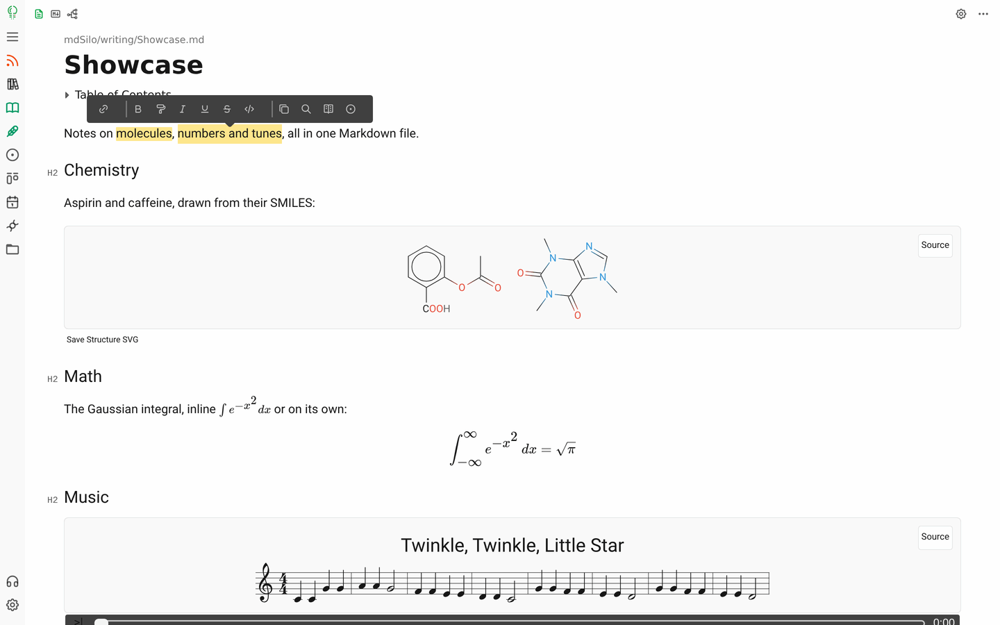

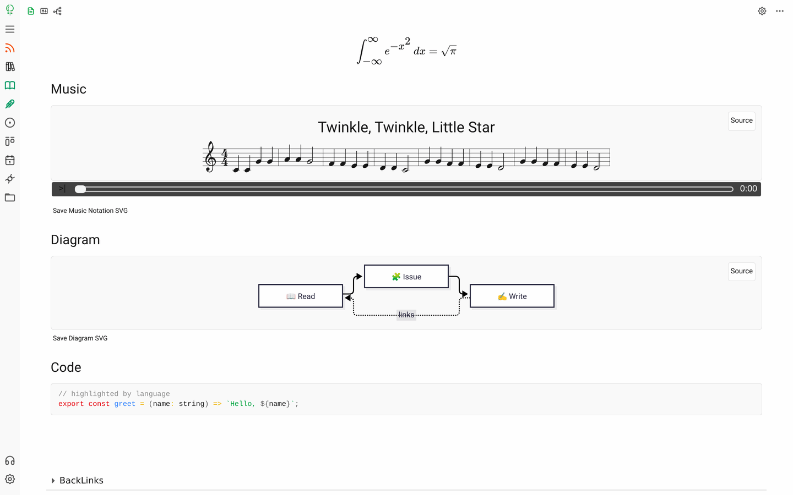

### 🔗 Link and see

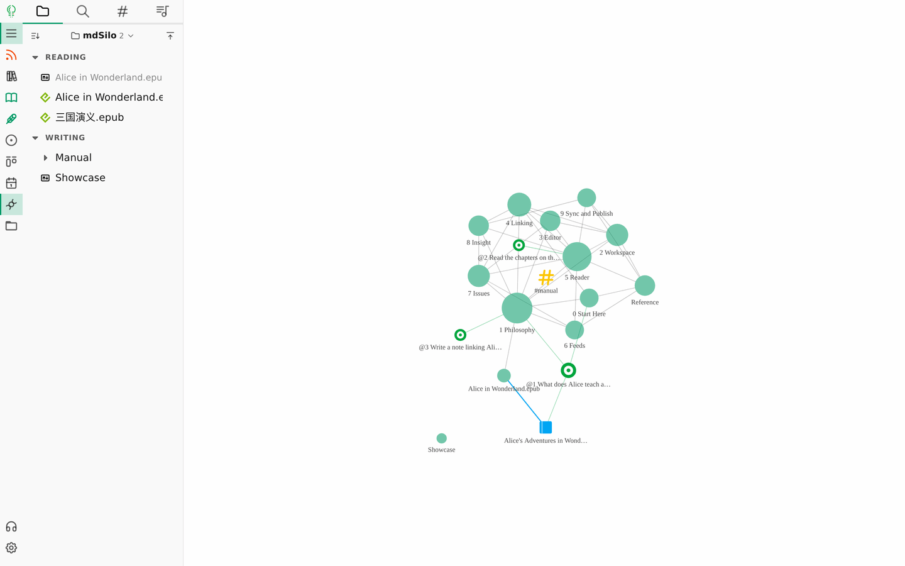

- **Bidirectional links**: `[[notes]]`, `{{books and highlights}}`, `[@12](issue:12)`, `#tags#`, backlinks and unlinked mentions
- **Graph**: notes, books, issues and tags in one network
- **Chronicle**: daily journals and a GitHub-like activity heat map of your writing *and* reading
- **Full-text search** over notes, annotations and the text of your books, Chinese included
- **Dark and light**, 10 themes and the ones you make; English, Spanish, Simplified and Traditional Chinese; Windows, macOS, Linux and Web (installable on a phone); free and open source

### 🔄 Sync and publish

- **Git sync** with GitHub, Gitea, GitLab or any git host over HTTPS with a token: commit, pull and push in one click, every few minutes or when the app closes. Books sync only if you choose; the token stays on the device
- **No lost edits**: changes on two devices merge; when both changed the same lines, your version is kept beside the note as a conflict copy, and the app's data merges field by field
- **Publish a static site** to GitHub Pages (or export it to a folder): the folders you tick, with backlinks, graph, search, tag pages, book annotations and issues with their milestones and boards. Math, mermaid, echarts and SMILES are drawn as you publish; links to private notes become plain text

### 🛠️ Plugins and customization

Make mdSilo your own:

- **Themes**: pick one of 10, or make your own in the theme editor: every color with a live preview and a warning when text gets hard to read, the corner radius and border width; import and copy daisyUI theme CSS. Themes sync with the workspace
- **Fonts**: import font files or use the fonts installed on your device, for the editor, its code, the reader, and CJK text
- **Plugins**: viewers for new file types, workspace views, actions on the text selected, commands, note modes, reader panels and code block renderers; sandboxed by default, with the permissions you grant. Try the [example plugins](examples/plugins)
- **Language** of the interface: English, Español, 简体中文, 繁體中文

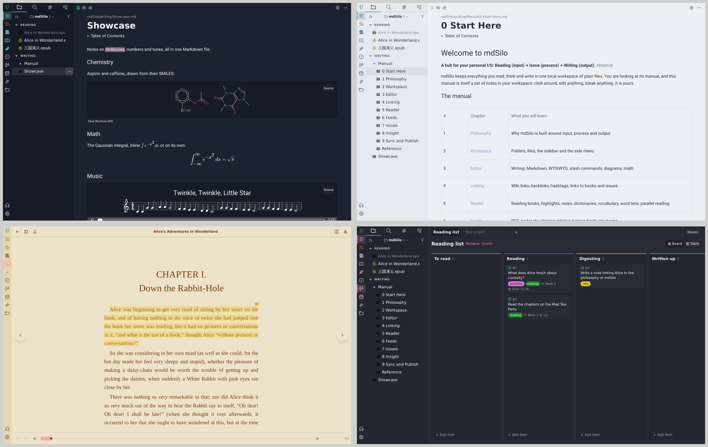

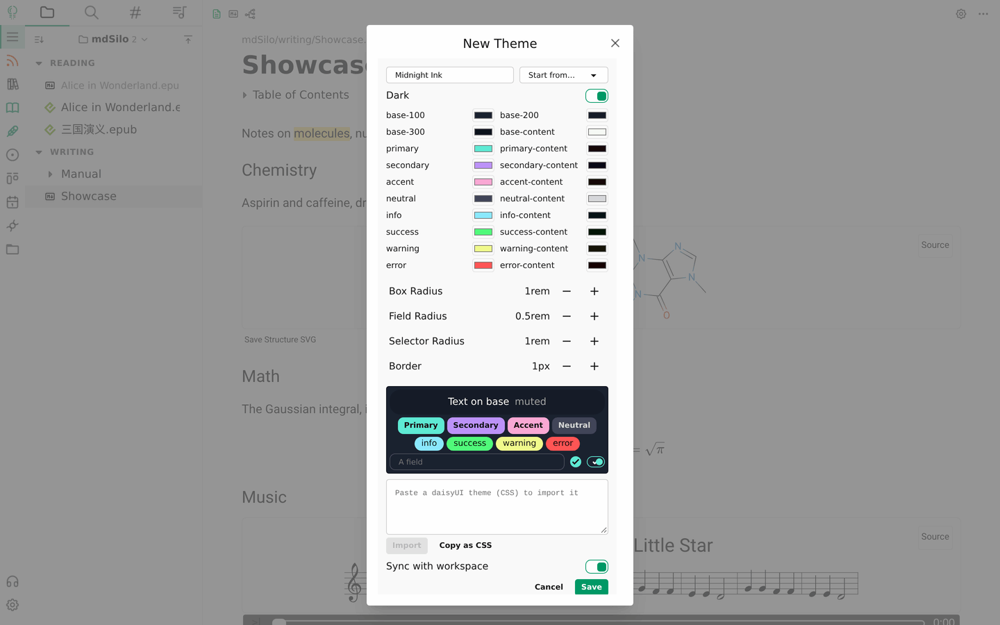

## Learn more

The [user manual](docs/manual/0%20Start%20Here.md) covers every part in detail (also in Chinese: [中文手册](docs/manual-zh/0%20开始.md)). The web version opens with the manual already in your workspace (in Chinese for a Chinese browser), together with a public domain sample book ([Project Gutenberg](https://www.gutenberg.org/ebooks/11)) and a few issues to play with; click around and break things. When you are done, **File Menu > Remove demo** clears all of it in one click and keeps what you made.

1. [Philosophy](docs/manual/1%20Philosophy.md)
2. [Workspace](docs/manual/2%20Workspace.md)
3. [Editor](docs/manual/3%20Editor.md)
4. [Linking](docs/manual/4%20Linking.md)
5. [Reader](docs/manual/5%20Reader.md)
6. [Feeds](docs/manual/6%20Feeds.md)
7. [Issues](docs/manual/7%20Issues.md)
8. [Insight](docs/manual/8%20Insight.md)
9. [Sync and Publish](docs/manual/9%20Sync%20and%20Publish.md)

Appendix: [Reference](docs/manual/Reference.md)

## Get the app

Install or update in one line; run it again to update. On Linux it picks the .deb, .rpm or AppImage for your distro, on macOS it puts the app in /Applications (options: `--version`, `--format`, `--uninstall`, see `--help`):

```sh
curl -fsSL https://raw.githubusercontent.com/mdSilo/mdSilo-app/main/scripts/install.sh | sh
```

On Windows, in PowerShell (no admin needed; options `-Version`, `-Format msi`, `-Uninstall`, see [install.ps1](scripts/install.ps1)):

```powershell
irm https://raw.githubusercontent.com/mdSilo/mdSilo-app/main/scripts/install.ps1 | iex
```

Once installed, the desktop app updates itself: on startup it asks GitHub for a newer release and offers to install it and restart (turn this off in Settings; About → Check for Updates asks at any time). The downloads are signed, and the app checks the signature before installing.

You can get the app on [release page](https://github.com/mdSilo/mdSilo-app/releases) or build from the source code: 

- install Rust: https://www.rust-lang.org/tools/install 
- install Node js: https://nodejs.org, and pnpm: `corepack enable` (or see https://pnpm.io/installation)
- `git clone https://github.com/mdSilo/mdSilo-app.git`
- `cd mdSilo-app`
- `pnpm install && pnpm tauri build` 

Then you can find the app in `./src-tauri/target/release` folder.

### Web version

The web version shares the frontend code in `./src` with the desktop app, files are stored in the browser (IndexedDB) instead of the disk. No Rust is needed: 

- `pnpm start:web`: dev server on http://localhost:3001
- `pnpm build:web`: build to `./dist-web`, a static site that can be served by any web server (set `MDSILO_WEB_BASE=/sub/path/` to serve from a sub path)

How it works: `vite.web.config.mts` replaces the Tauri APIs (`@tauri-apps/api/*`, `@tauri-apps/plugin-dialog`) with the stand-ins in `./src/host/web`, which handle the same commands as the Rust end (`src-tauri/src/lib.rs`) on a virtual file system in IndexedDB. A service worker (`./web/public/fs-sw.js`) serves the stored files by URL, so images and attachments can be displayed. It also makes the web version an installable app (PWA, `web/public/manifest.webmanifest`): the build writes its files into the worker (`web/pwa-precache.mjs`), which keeps them for offline use; a new build installs as an update the app offers to reload into. Folders and files on your device can be imported via the Open Folder / Open File dialog, exported files are downloaded by the browser.

Backup: clearing the site data of the browser deletes the notes, so back up regularly via the **File Menu** (the folder icon of the side menu) > **Backup**, which downloads all files as a zip (made of the stored files themselves, so large books are not copied into memory), and restore it via **File Menu > Restore Backup**. **Settings > Storage** shows the space used, whether the browser keeps the data when short of space (and asks it to), the last backup, backs up to a folder of the device where the browser can write one (Chromium), and clears all data. A full storage is reported with the space used; the app reminds you to back up after 14 days of changes without one. The search index is saved in IndexedDB too: on the next open only the notes changed since are indexed again.

RSS feeds: browsers block most feeds by CORS, so a feed is fetched directly first, then via a CORS proxy. The proxy in use, in order:

1. Settings > **CORS Proxy** (its dialog says which proxy is in use, and whether the site has one of its own), e.g. `https://proxy.example.com/?url={url}` (`{url}` is replaced by the encoded feed url, otherwise the url is appended); `none` to disable
2. build time default: `MDSILO_WEB_CORS_PROXY=https://proxy.example.com/?url={url} pnpm build:web`
3. the built-in proxy `/__cors_proxy__` of `pnpm start:web` / `pnpm preview:web`, if detected
4. a public proxy ([allorigins](https://allorigins.win)) on static hosting, which can see the feed urls

AI on the web: a provider that does not answer browsers is reached through the same proxy, as a relay: `POST <proxy>?url=<target>`, only the API headers (key, version, content type) sent on, the answer streamed back, and only to the AI and search hosts it knows (Anthropic, OpenAI, OpenRouter, Groq, DeepSeek, Mistral, Together, Brave, Tavily) plus `RELAY_HOSTS`. Your keys pass through it, so it is used only with 1–3 above, **never the public proxy**.

To run your own proxy (same API: GET to public http(s) addresses, and the AI relay):

- Node: `node web/cors-proxy.mjs` (no dependencies; env `PORT`, default 8787, `HOST`, `ALLOW_ORIGIN`, `RELAY_HOSTS=host1,host2` for more AI hosts)
- Cloudflare Workers, for static hosting w/o a server (free tier is enough): `npx wrangler deploy web/cors-proxy-worker.mjs --name mdsilo-cors-proxy --compatibility-date 2024-09-01 --var ALLOW_ORIGIN:https://<your site origin>` (add `--var RELAY_HOSTS:host1,host2` for more AI hosts)

Deploy to GitHub Pages: `.github/workflows/deploy-web.yml` builds and deploys on push to `main` (or run it manually). Enable it in repo Settings > Pages > Source: **GitHub Actions**. With repo secrets `CLOUDFLARE_API_TOKEN` (Workers edit permission) and `CLOUDFLARE_ACCOUNT_ID`, it also deploys the Cloudflare Worker proxy and builds it in as the default; or set repo variable `MDSILO_WEB_CORS_PROXY` to use an existing proxy. Other variables: `MDSILO_WEB_BASE` (default `/<repo name>/`, use `/` for a custom domain), `MDSILO_WEB_ORIGIN` (origin allowed by the proxy, default `https://<owner>.github.io`), `MDSILO_CORS_WORKER_NAME`.

## Tech Stack

- Editor Framework: [ProseMirror](https://prosemirror.net/)      
- Frontend Framework: [React](https://reactjs.org/)  
- Cross-platform: [Tauri](https://tauri.app/) 

## Road map

### Input

- [X] RSS, Atom, JSON Feed and podcasts
- [X] Read and annotate EPUB, PDF, MOBI, FB2, CBZ; library, parallel reading, vertical writing, comics and manga, dictionaries (web and MDict), vocabulary, word lens, read aloud, whole-book translation
- [X] Feeds into books
- [X] OPDS catalogs
- [ ] AI helpers

### Process

- [X] Issues, labels, milestones, subtasks, due dates
- [X] Projects: boards and tables
- [X] Tasks in notes, issues from highlights and selections
- [X] Vocabulary: record and revise the new things  
- [ ] Flashcards

### Output

- [X] Markdown: style, link, image, headings and TOC, lists, tables, quotes
- [X] Extensions: mark, underline, sup and sub, highlighted code, math and chemistry, notices, wikilink `[[]]`, hashtag `#tag#`, diagrams (mermaid, echarts, abc), chemical structures (SMILES), embeds, attached PDF
- [X] WYSIWYG, Markdown and Mind Map; slash commands, hovering toolbar, hotkeys
- [X] Export as PDF and PNG
- [ ] Drawing
- [ ] Block reference
- [X] Publish a static site (GitHub Pages)

### Link and see

- [X] Backlinks, unlinked mentions, links to books and issues
- [X] Graph, Chronicle, activity heat map
- [X] Full-text search
- [X] Version control: git sync

### Extension

- [X] Plugin, some examples: https://github.com/mdSilo/mdSilo-app/tree/main/examples/plugins
- [X] Custom themes and fonts
- [X] Dictionary: .mdx/.mdd mdict dictionary files
- [X] Interface in English, Spanish, Simplified and Traditional Chinese

### Cross-platform

- [X] Windows, macOS, Linux
- [X] Web: https://mdsilo.github.io/mdSilo-app/
- [ ] Mobile: iOS/iPadOS and Android


## Any questions, feedback or suggestions?

You can follow us on [Bluesky](https://bsky.app/profile/mdsilo.com) or go to our [Discord](https://discord.gg/EXYSEHRTFt). We are waiting there for you.
