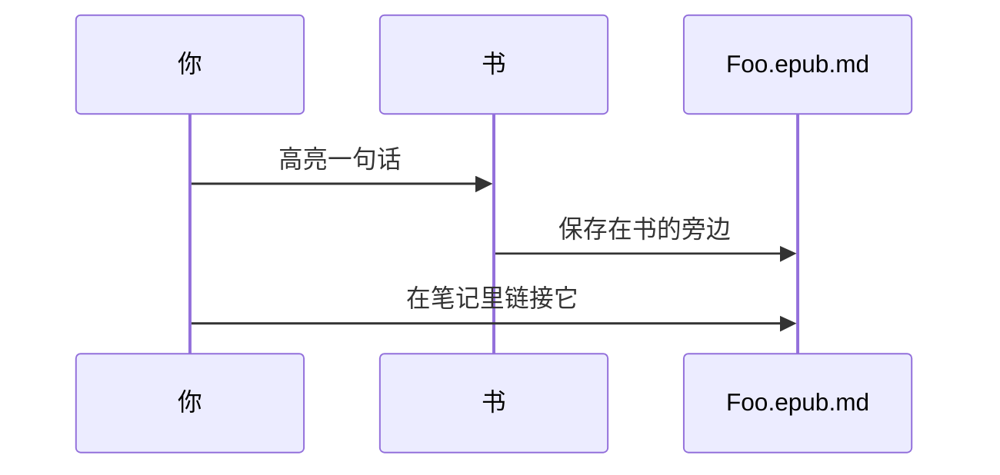

# 编辑器

#手册#

编辑器是 mdsmirror，一个基于 ProseMirror 的所见即所得 Markdown 编辑器。你看到的是排好版的文字，保存下来的是纯 Markdown。停止输入片刻后，笔记会自动保存。

## 三种看笔记的方式

笔记左上角的按钮用来切换模式：

| 模式 | 用来 |
|------|------|
| **WYSIWYG** | 所见即所得。默认模式。 |
| **Markdown** | 带语法高亮的Markdown源码（CodeMirror）。适合精细控制和粘贴。 |
| **MindMap** | 把笔记里的标题和列表变成思维导图，简练清晰。 |

切换不会丢东西：它们是同一个文件。模式旁边的齿轮打开 **Editor Settings**：字体、代码字体（也用于 Markdown 模式的文字）、CJK 字体（其它字体里没有的中日韩文字用它）、字号、行高和字重（用 − 和 + 调）、从右到左、拼写检查和附件文件夹。

## 斜杠命令

在空行输入 `/` 打开命令菜单，继续输入来过滤，回车插入。

- Image、File（附加本地文件，PDF 会内嵌显示）、Drawing（见下文）
- 日期、时间、日期和时间
- 大、中、小标题
- 任务列表、无序列表、有序列表
- Link、Table、Quote、Code block、Comment、Math equation、Divider、Page break
- Info、Warning、Tip 提示块

很多块也有 Markdown 快捷写法，手不用离开键盘：`# ` 标题，`- ` 列表，`> ` 引用，` ``` ` 代码块，`---` 分割线，`:::` 提示块。

## 格式

选中文字，上方会出现**工具栏**：链接、加粗、高亮、斜体、下划线、删除线、行内代码、**Copy**（纯文本）、**Dictionary**（查词，最多六个词，和阅读器里一样用你的词典，见 [[5 阅读器|阅读器]]；可加入生词本）和 **New issue of it**（见 [[7 Issue|Issue]]）。这些格式也有快捷键。

| 格式 | 快捷键 | Markdown |
|------|--------|----------|
| **加粗** | `Ctrl/Cmd + B` | `**加粗**` |
| *斜体* | `Ctrl/Cmd + I` | `*斜体*` |
| 下划线 | `Ctrl/Cmd + U` | `__下划线__` |
| ~~删除线~~ | `Ctrl/Cmd + D` | `~~文字~~` |
| ==高亮== | `Ctrl/Cmd + H` | `==高亮==` |
| `行内代码` | `Ctrl/Cmd + 反引号` | `` `code` `` |
| 链接 | `Ctrl/Cmd + K` | `[文字](网址)` |
| 上标，如 E=mc^2^ | `Alt + P` | `^sup^` |
| 下标，如 H~2~O | `Alt + B` | `~sub~` |

点击标题旁的箭头可以折叠标题；有标题的笔记，标题下面会显示目录。表格有行、列的手柄，可以插入、删除、移动、排序和对齐。

## Markdown扩展

### 数学和化学

行内：$E = mc^2$。独立公式：

$$
\int_{-\infty}^{\infty} e^{-x^2}\,dx = \sqrt{\pi}
$$

化学方程式用 `\ce`：$\ce{CO2 + C -> 2 CO}$

### 提示块

:::info
*info* 提示块，用来补充背景。
:::

:::warning
*warning* 提示块，用来提醒容易踩的坑。
:::

:::tip
*tip* 提示块，用来给出捷径。
:::

### 图表

语言为 `mermaid`、`echarts` 或 `abcjs` 的代码块会被画成图，你仍然可以编辑它的源码。用 `abcjs`（ABC 记谱法）写的乐谱可以播放；每幅图（图表、乐谱、分子结构）都可以存成 SVG。



```echarts
{
  "xAxis": { "type": "category", "data": ["读", "想", "写"] },
  "yAxis": { "type": "value" },
  "series": [{ "type": "bar", "data": [5, 3, 8] }]
}
```

### 化学结构

语言为 `smiles` 的代码块按 [SMILES](https://zh.wikipedia.org/wiki/简化分子线性输入规范) 每行画一个分子，或一个反应（`反应物>试剂>产物`）。写错的行显示错误。

```smiles
CC(=O)Oc1ccccc1C(=O)O
CN1C=NC2=C1C(=O)N(C(=O)N2C)C
```

### 代码

```ts
// 按语言高亮
export const greet = (name: string) => `Hello, ${name}`;
```

### 嵌入

把 YouTube 或 Figma 的链接单独粘贴在一行，它就变成内嵌的播放器或设计稿。图片可以粘贴、拖入，或用 `/image` 插入；它们会被复制到工作区的附件文件夹。

### 注释

`<!-- 像这样 -->` 是注释：存在文件里，页面上不显示。

## 两篇笔记并排

笔记右上角的 *Open beside*（两栏图标）在旁边打开另一篇笔记：最近写过的、按标题找到的，或新建一篇。在侧栏里按住 Ctrl、⌘ 或 Alt 点笔记也一样。两篇都能编辑；旁边那篇里点的链接在它自己那一栏打开，插件作用于最后用过的那篇。*Swap sides* 把它换到左边，叉号关闭；拖动两篇之间的线调整宽度（双击恢复各占一半）。打开别的笔记或一本书时，旁边的笔记还在：用同一菜单的 *Read beside* 页签边读边写（见 [[5 阅读器|阅读器]]）。同一篇笔记不能两边同时打开：在主栏打开它，旁边那栏就关掉。手机上没有。

## 绘图

用 [Excalidraw](https://excalidraw.com) 画：形状、箭头、手绘、文字、图片。一幅画是 `drawing/` 里的一个文件（见 [[2 工作区|工作区]]），边画边存，旁边是它的图片（SVG）。

- **新建**：侧边菜单羽毛笔下的 *New Drawing*（`Alt + N`）、笔记斜杠菜单里的 *Drawing*（图片插入笔记的光标处），或在侧栏点 `.excalidraw` 文件打开。
- **在笔记或书旁边**：*Open beside*（笔记）或 *Parallel reading*（书）菜单的 *Draw beside* 页签：新建一幅，或选 `drawing/` 里的（最近改过的在前）。
- **在哪里打开**：在当前笔记或书旁边，和旁边的笔记一样（拖动中间的线调整宽度）；手机上盖住整页；其他视图里单独打开。栏头有 *Insert into the note*（把图片插到光标处）、*Open alone*、*Open in a window*（桌面版）和关闭。同一菜单的 *New Drawing in a Window* 在新窗口中新建（桌面版）；按住 Ctrl/⌘/Alt 点侧栏里的绘图：在旁边打开。
- **在笔记里**它就是一张普通图片，``，所以凡是显示 Markdown 的地方都能看到，GitHub 上也是，发布时随笔记一起发布。双击图片，或选中后点工具栏的铅笔，在笔记旁改这幅画；停笔后图片跟着更新。暗色主题下图片反色显示，和 Excalidraw 一样。
- **重命名或移动**：点画布栏头的名字直接改（回车确定，Esc 取消），或在侧栏里从任一文件的菜单（三个点），或拖到别的文件夹：图片跟着一起，笔记里的图片和打开着的画也跟着更新。在应用外改了其中一个也一样。不会覆盖同名的文件。
- **从书里**：把书的高亮或文字拖到旁边的绘图上，成为一段文字，链接回书中的位置。
- **链接**：形状的链接（Excalidraw 里 Ctrl/⌘ + K）可以是笔记标题、`book:`、`issue:N` 或网址，和笔记里一样打开。

## 导出

笔记右上角的选项菜单（三个点）可以导出为 **PDF** 或 **PNG**。文件本身已经是 Markdown 了。

下一章：[[4 链接|链接]]。
