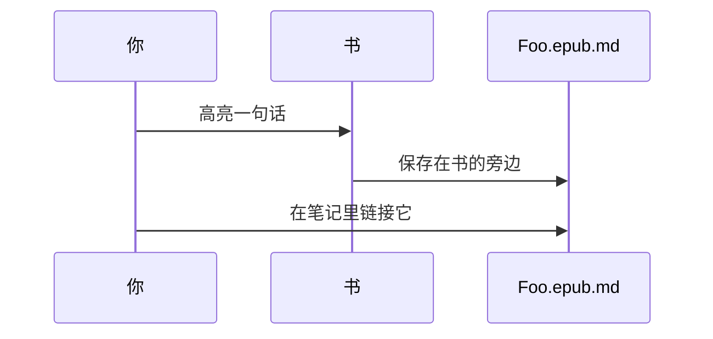

# 编辑器

#手册#

编辑器是 mdsmirror，一个基于 ProseMirror 的所见即所得 Markdown 编辑器。你看到的是排好版的文字，保存下来的是纯 Markdown。停止输入片刻后，笔记会自动保存。

## 三种看笔记的方式

笔记左上角的按钮用来切换模式：

| 模式 | 用来 |
|------|------|
| **WYSIWYG** | 所见即所得。默认模式。 |
| **Markdown** | 带语法高亮的Markdown源码（CodeMirror）。适合精细控制和粘贴。 |
| **MindMap** | 把笔记里的标题和列表变成思维导图，简练清晰。 |

切换不会丢东西：它们是同一个文件。模式旁边的齿轮打开 **Editor Settings**：字体、字号、行高、字重、从右到左、拼写检查和附件文件夹。

## 斜杠命令

在空行输入 `/` 打开命令菜单，继续输入来过滤，回车插入。

- Image、File（附加本地文件，PDF 会内嵌显示）
- 日期、时间、日期和时间
- 大、中、小标题
- 任务列表、无序列表、有序列表
- Link、Table、Quote、Code block、Comment、Math equation、Divider、Page break
- Info、Warning、Tip 提示块

很多块也有 Markdown 快捷写法，手不用离开键盘：`# ` 标题，`- ` 列表，`> ` 引用，` ``` ` 代码块，`---` 分割线，`:::` 提示块。

## 格式

选中文字，上方会出现**工具栏**：链接、加粗、高亮、斜体、下划线、删除线、行内代码、**Copy**（纯文本）和 **New issue of it**（见 [[7 Issue|Issue]]）。这些格式也有快捷键。

| 格式 | 快捷键 | Markdown |
|------|--------|----------|
| **加粗** | `Ctrl/Cmd + B` | `**加粗**` |
| *斜体* | `Ctrl/Cmd + I` | `*斜体*` |
| 下划线 | `Ctrl/Cmd + U` | `__下划线__` |
| ~~删除线~~ | `Ctrl/Cmd + D` | `~~文字~~` |
| ==高亮== | `Ctrl/Cmd + H` | `==高亮==` |
| `行内代码` | `Ctrl/Cmd + 反引号` | `` `code` `` |
| 链接 | `Ctrl/Cmd + K` | `[文字](网址)` |
| 上标，如 E=mc^2^ | | `^sup^` |

点击标题旁的箭头可以折叠标题；有标题的笔记，标题下面会显示目录。表格有行、列的手柄，可以插入、删除、移动、排序和对齐。

## Markdown扩展

### 数学和化学

行内：$E = mc^2$。独立公式：

$$
\int_{-\infty}^{\infty} e^{-x^2}\,dx = \sqrt{\pi}
$$

化学方程式用 `\ce`：$\ce{CO2 + C -> 2 CO}$

### 提示块

:::info
*info* 提示块，用来补充背景。
:::

:::warning
*warning* 提示块，用来提醒容易踩的坑。
:::

:::tip
*tip* 提示块，用来给出捷径。
:::

### 图表

语言为 `mermaid`、`echarts` 或 `abcjs` 的代码块会被画成图，你仍然可以编辑它的源码。



```echarts
{
  "xAxis": { "type": "category", "data": ["读", "想", "写"] },
  "yAxis": { "type": "value" },
  "series": [{ "type": "bar", "data": [5, 3, 8] }]
}
```

### 代码

```ts
// 按语言高亮
export const greet = (name: string) => `Hello, ${name}`;
```

### 嵌入

把 YouTube 或 Figma 的链接单独粘贴在一行，它就变成内嵌的播放器或设计稿。图片可以粘贴、拖入，或用 `/image` 插入；它们会被复制到工作区的附件文件夹。

### 注释

`<!-- 像这样 -->` 是注释：存在文件里，页面上不显示。

## 导出

笔记右上角的选项菜单（三个点）可以导出为 **PDF** 或 **PNG**。文件本身已经是 Markdown 了。

下一章：[[4 链接|链接]]。
