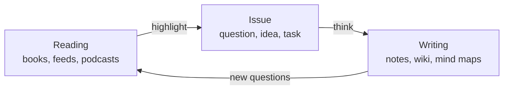

# Philosophy

#manual#

For a human brain, reading and writing are the I/O: the way the thinking system talks with the outside world. A note app usually looks after the last step only, the writing. But writing without reading is empty, and reading without a way to digest it is forgotten within a week.

mdSilo is a **hub for personal I/O**. It has one place for each of the three steps, and they are tied together by links.

## 1. Reading is the input

Information comes in from books (EPUB, PDF, MOBI, FB2, CBZ and more), from RSS and Atom feeds, from podcasts and from web pages you clip. Everything you read can be marked up: a highlight, a note on a sentence, a bookmark. The marks are plain Markdown, next to the book. See [[5 Reader|Reader]] and [[6 Feeds|Feeds]].

## 2. Issue is the process

Input is raw. To digest it you need a place for the questions it raises, the ideas it sparks and the work it calls for. mdSilo borrows the best tool for that: the **issue tracker**. An issue is a unit of thought that has a state (open or closed), labels, a milestone, comments and a timeline, and that can sit on a project board. A highlight in a book, a sentence in a note or a checkbox can all become an issue. See [[7 Issues|Issues]].

## 3. Writing is the output

What comes out is writing: notes, essays, a personal wiki, mind maps, diagrams. The editor is WYSIWYG, but the files are plain Markdown, so they will outlive any app. See [[3 Editor|Editor]].

## Linking is the glue

The three steps are not a pipeline in a line, they are a loop, and **links** close it. A note can link to a book (`{{Alice's Adventures in Wonderland}}`), to a highlight in that book, to an issue (`[@1](issue:1)`) and to other notes (`[[Linking]]`). Every link is two-way: the target knows who points at it. The Graph then draws the whole network, a sky of stars you built yourself. See [[4 Linking|Linking]] and [[8 Insight|Insight]].

## Principles

- **Local first.** Your data is files in a folder you choose. No account, no server, no tracking. The web version keeps files in your browser instead of a disk.
- **Plain text forever.** Notes are Markdown; annotations are Markdown; issues are JSON. Open them with any tool, sync them with git.
- **One workspace, no silos.** Reading, thinking and writing share one search, one link index and one graph.
- **Small and fast.** A tool that gets out of the way. Everything loads on demand, the index is incremental.
- **Yours to shape.** Themes, fonts, slash commands, hotkeys, and your own folder structure.

Next: [[2 Workspace|Workspace]].
