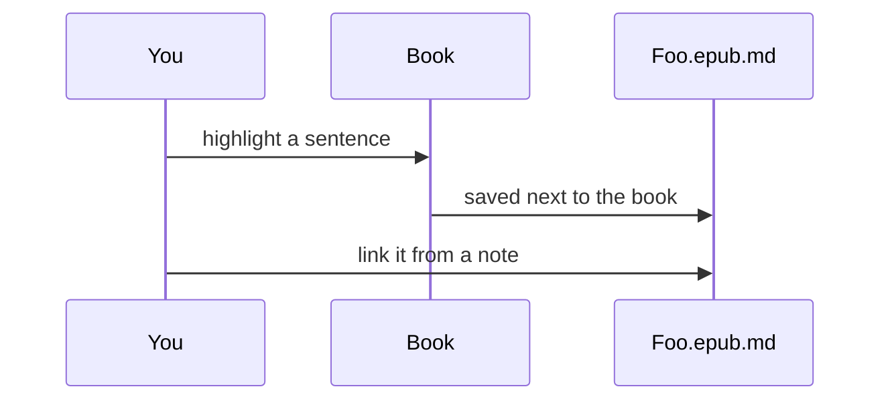

# Editor

#manual#

The editor is mdsmirror, a WYSIWYG Markdown editor built on ProseMirror. What you see is formatted text; what is saved is plain Markdown. Notes are saved automatically a moment after you stop typing.

## Three ways to look at a note

The buttons at the top left of a note switch the mode:

| Mode | Use it to |
|------|-----------|
| **WYSIWYG** | Write with formatting shown as you type. The default. |
| **Markdown** | Edit the source with syntax highlighting (CodeMirror). Good for fine control and pasting. |
| **MindMap** | Turn the headings and lists of the note into a mind map, and edit it as a tree. |

Switching is lossless: it is the same file. The gear next to the modes opens **Editor Settings**: font, size, line height, weight, right-to-left, spell check and the attachment folder.

## Slash commands

Type `/` on an empty line to open the command menu, then keep typing to filter. Press Enter to insert.

- Image, File (attach a local file; PDFs are shown inline)
- Date, Time, Date and time
- Big, medium and small heading
- Task list, bulleted list, ordered list
- Link, Table, Quote, Code block, Comment, Math equation, Divider, Page break
- Info, Warning and Tip notice

Many blocks also have a Markdown shortcut, so you never have to leave the keyboard: `# ` for a heading, `- ` for a list, `> ` for a quote, ` ``` ` for a code block, `---` for a divider, `:::` for a notice.

## Formatting

Select text and a **toolbar** appears above it: link, bold, highlight, italic, underline, strikethrough, inline code, **Copy** (plain text) and **New issue of it** (see [[7 Issues|Issues]]). The same marks have hotkeys.

| Mark | Hotkey | Markdown |
|------|--------|----------|
| **Bold** | `Ctrl/Cmd + B` | `**bold**` |
| *Italic* | `Ctrl/Cmd + I` | `*italic*` |
| Underline | `Ctrl/Cmd + U` | `__underline__` |
| ~~Strikethrough~~ | `Ctrl/Cmd + D` | `~~text~~` |
| ==Highlight== | `Ctrl/Cmd + H` | `==highlight==` |
| `Inline code` | `Ctrl/Cmd + backtick` | `` `code` `` |
| Link | `Ctrl/Cmd + K` | `[text](url)` |
| Superscript, as in E=mc^2^ | | `^sup^` |

Headings can be folded by clicking the arrow beside them, and a table of contents is shown under the title of a note that has headings. Tables have row and column handles for inserting, deleting, moving, sorting and aligning.

## Beyond plain Markdown

### Math and chemistry

Inline: $E = mc^2$. Display:

$$
\int_{-\infty}^{\infty} e^{-x^2}\,dx = \sqrt{\pi}
$$

Chemical equations work through `\ce`: $\ce{CO2 + C -> 2 CO}$

### Notices

:::info
An *info* notice, for context.
:::

:::warning
A *warning* notice, for things that bite.
:::

:::tip
A *tip* notice, for shortcuts.
:::

### Diagrams

A code block with the language `mermaid`, `echarts` or `abcjs` is drawn as a diagram, and you can still edit its source.



```echarts
{
  "xAxis": { "type": "category", "data": ["Read", "Think", "Write"] },
  "yAxis": { "type": "value" },
  "series": [{ "type": "bar", "data": [5, 3, 8] }]
}
```

### Code

```ts
// highlighted by language
export const greet = (name: string) => `Hello, ${name}`;
```

### Embeds

Paste a YouTube or Figma link on its own line and it becomes an embedded player or design. Images can be pasted, dragged in or inserted by `/image`; they are copied into the attachment folder of the workspace.

### Comments

`<!-- like this -->` is a comment: stored in the file, hidden from the page.

## Export

The options menu (the dots at the top right of a note) exports it as **PDF** or **PNG**. The file itself is already Markdown.

Next: [[4 Linking|Linking]].
